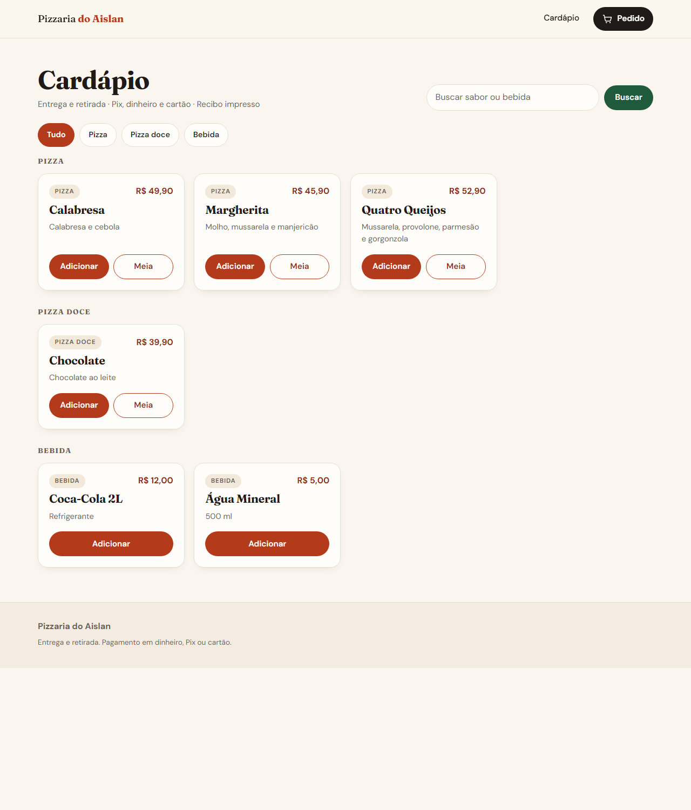
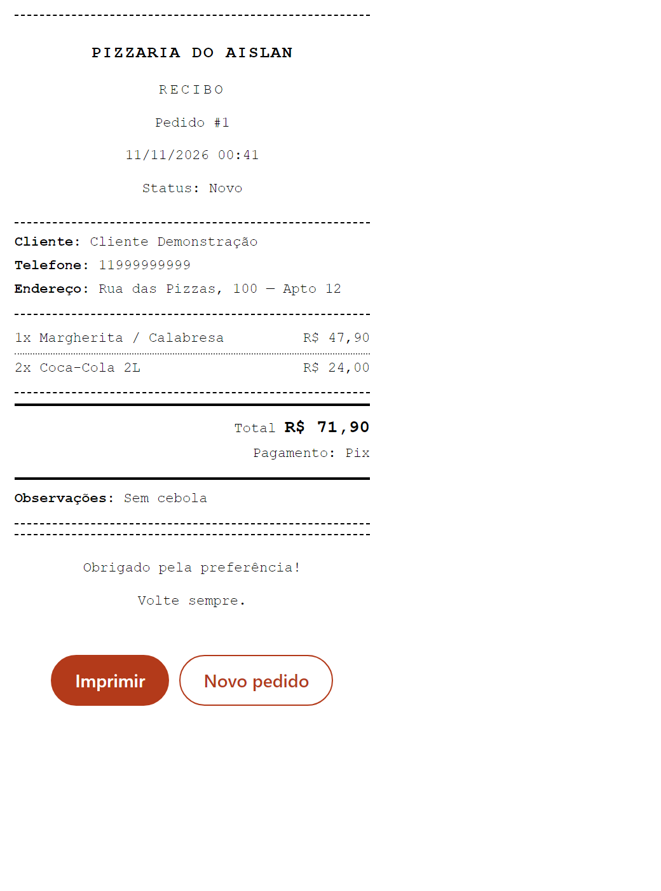

# Pizza Order System

[](https://github.com/kaikysousa/PizzariaDjango/actions/workflows/ci.yml)
[](https://github.com/kaikysousa/PizzariaDjango/releases)
[](https://www.python.org/)
[](https://www.djangoproject.com/)
[](LICENSE)

Django application for menu browsing, cart, checkout, and receipt printing on an 80 mm thermal printer.

[Ler em português](README.md)

## Screenshots



### 80 mm receipt



## Features

- Menu with search, category filter, and pagination.
- Browser cart with half-and-half pizzas (two flavors).
- Checkout with customer details, condominium, and payment method.
- Customer orders with store approval and token-based tracking.
- Owner panel to approve, refuse, edit, and advance orders.
- Counter orders created by the owner, with server-side total recalculation.
- Optional ingredient and recipe stock control with low-stock alerts.
- 80 mm receipt with larger type, ready for browser printing.
- Product, condominium, ingredient, and recipe management through the Django admin.

## Requirements

- Python 3.12+
- Django 5.2.18 (LTS)
- 80 mm thermal printer paired on Windows (for physical printing)

## Setup

```bash
python -m venv .venv
.venv\Scripts\activate
pip install -r requirements-dev.txt
copy .env.example .env
# edit .env and set DJANGO_DB_PATH=db.sqlite3
python manage.py migrate
python manage.py createsuperuser
python manage.py runserver
```

Open `http://127.0.0.1:8000/`. The admin is at `/admin/`. The store panel is at `/painel/` and requires a staff user.

Before running `migrate`, edit `.env` and set `DJANGO_DB_PATH=db.sqlite3`.
The example file leaves it empty, and Django refuses to connect without a database name.

## Testing locally

The [test manual](docs/MANUAL-DE-TESTES.md) is in Portuguese and covers prerequisites, test data, ten manual scripts with expected results and evidence, automated tests, and troubleshooting.

## Environment variables

| Variable | Default | Purpose |
|---|---|---|
| `DJANGO_DEBUG` | `1` | `0` in production |
| `DJANGO_SECRET_KEY` | empty | required when `DJANGO_DEBUG=0` |
| `DJANGO_ALLOWED_HOSTS` | `127.0.0.1,localhost` | comma-separated hosts |
| `DJANGO_DB_PATH` | `db.sqlite3` | SQLite database path |
| `DJANGO_SECURE_SSL_REDIRECT` | `1` | redirects HTTP to HTTPS in production |
| `DJANGO_HSTS_SECONDS` | `31536000` | HSTS in production |
| `PIZZARIA_CNPJ` | empty | optional CNPJ on the receipt |

The `.env` file is loaded automatically by `python-dotenv`.

## Tests

```bash
python manage.py test
```

When `DJANGO_DEBUG=0` is set in the environment, run `DJANGO_DEBUG=1 python manage.py test`. The suite depends on development mode: in production, `collectstatic` requires a manifest and `SECURE_SSL_REDIRECT` returns 301.

### Quality

- 160 tests in `pedidos/tests/`, `enderecos/tests.py`, `estoque/tests.py`, and `painel/tests.py`, covering catalog, intake, condominiums, status, stock, panel, receipt, and the full E2E flow.
- CI in `.github/workflows/ci.yml`: tests, secret gate, security gate, deploy gate, and Ruff.
- Receipt gate: `python scripts/check_receipt_pdf.py` prints the receipt to PDF and checks the 80 mm width.

## Production

```bash
set DJANGO_DEBUG=0
set DJANGO_SECRET_KEY=<long-random-key>
set DJANGO_ALLOWED_HOSTS=your-domain.com
python manage.py collectstatic --noinput
gunicorn DjangoProject.wsgi
```

WhiteNoise serves collected static files. Use HTTPS and a reverse proxy for TLS.

## Printing

1. Pair the thermal printer on Windows and install the driver.
2. Open an order receipt and click **Print**.
3. Select the printer and 80 mm paper in the browser dialog.
4. The CSS uses `@page { size: 80mm auto; size: 80mm 297mm; margin: 0 }`. The second value is the Chrome fallback; the driver must respect the width.

The browser does not send Bluetooth print jobs directly. Pairing and drivers belong to the operating system.

## Structure

```
DjangoProject/        configuration
pedidos/              app: models, services, views, forms, admin, tests
enderecos/            condominiums
estoque/              ingredients, recipes, and stock movements
painel/               owner panel
templates/            base, menu, checkout, panel, and receipt
static/css/           tokens, styles, and receipt CSS
static/js/            cart and motion
scripts/              audit gates
```

## Limitations

- Does not process online payments; it records the selected method.
- Does not issue fiscal documents. CNPJ is optional and comes from `PIZZARIA_CNPJ`.
- No customer authentication; the receipt uses a UUID token with `noindex`.
- SQLite is the default development database.
