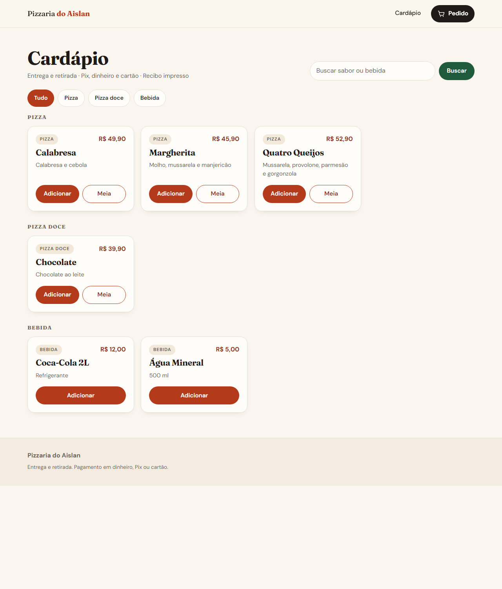
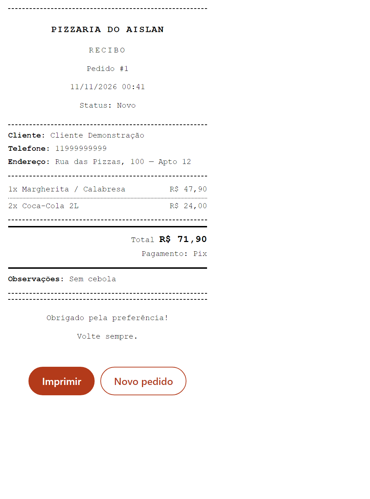
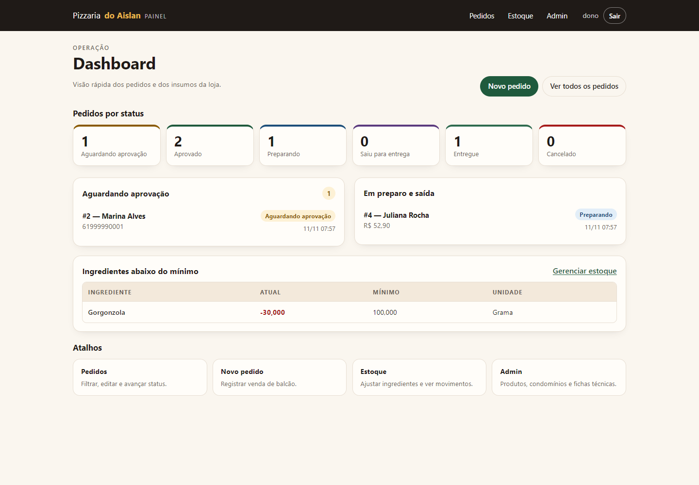
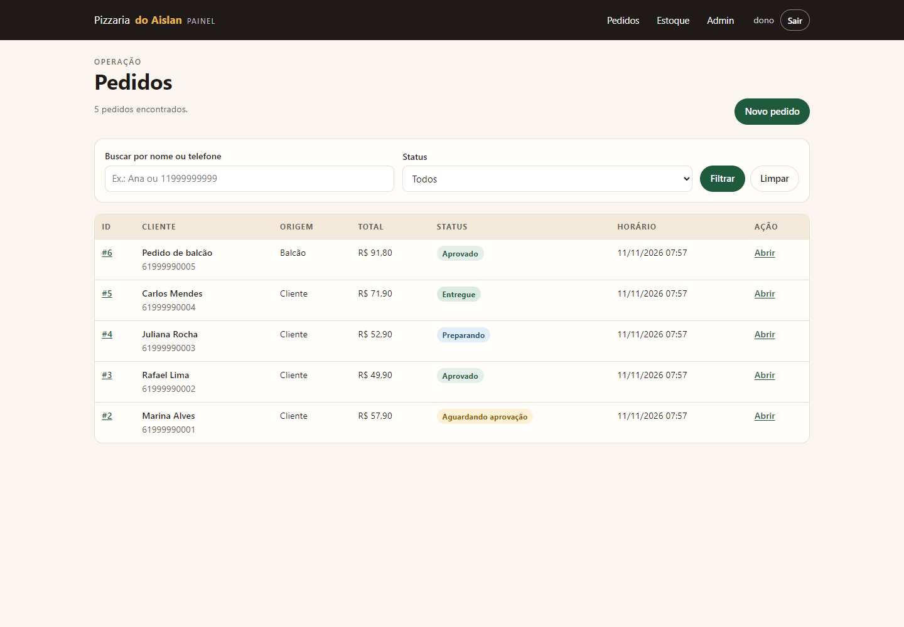

# Sistema de Pedidos — Pizzaria

[](https://github.com/kaikysousa/PizzariaDjango/actions/workflows/ci.yml)
[](https://github.com/kaikysousa/PizzariaDjango/releases)
[](https://www.python.org/)
[](https://www.djangoproject.com/)
[](LICENSE)

Aplicação Django para cardápio, carrinho, checkout e impressão de recibo em impressora térmica de 80 mm.

[Read in English](README.en.md)

## Screenshots



### Recibo de 80 mm



### Painel do dono





## Funcionalidades

- Cardápio com busca, filtro por categoria e paginação.
- Carrinho no navegador, com meia pizza (dois sabores).
- Checkout com dados do cliente, condomínio e forma de pagamento.
- Pedido do cliente com aprovação da loja e acompanhamento por token.
- Painel do dono para aprovar, recusar, editar e avançar pedidos.
- Pedido de balcão criado pelo dono, com total recalculado no servidor.
- Controle opcional de estoque por ingrediente e ficha técnica, com alerta de mínimo.
- Recibo de 80 mm com fonte maior, pronto para impressão pelo navegador.
- Administração de produtos, condomínios, ingredientes e fichas no Django admin.

## Requisitos

- Python 3.12+
- Django 5.2.18 (LTS)
- Impressora térmica de 80 mm pareada no Windows (para impressão física)

## Instalação

```bash
python -m venv .venv
.venv\Scripts\activate
pip install -r requirements-dev.txt
copy .env.example .env
# confira .env (DJANGO_DB_PATH=db.sqlite3)
python manage.py migrate
python manage.py createsuperuser
python manage.py runserver
```

Abra `http://127.0.0.1:8000/`. O admin fica em `/admin/`. O painel da loja fica em `/painel/` e exige usuário staff.

O `.env.example` já traz `DJANGO_DB_PATH=db.sqlite3`. Se o valor ficar vazio, o Django recusa a conexão sem um nome de banco.

## Testar localmente

O [Manual de testes](docs/MANUAL-DE-TESTES.md) reúne pré-requisitos, massa de dados, dez roteiros manuais com resultado esperado e evidência, testes automatizados e solução de problemas.

## Variáveis de ambiente

| Variável | Padrão | Uso |
|---|---|---|
| `DJANGO_DEBUG` | `1` | `0` em produção |
| `DJANGO_SECRET_KEY` | vazio | obrigatória quando `DJANGO_DEBUG=0` |
| `DJANGO_ALLOWED_HOSTS` | `127.0.0.1,localhost` | hosts separados por vírgula |
| `DJANGO_DB_PATH` | `db.sqlite3` | caminho do banco SQLite |
| `DJANGO_SECURE_SSL_REDIRECT` | `1` | redireciona HTTP para HTTPS em produção |
| `DJANGO_HSTS_SECONDS` | `31536000` | HSTS em produção |
| `PIZZARIA_CNPJ` | vazio | CNPJ opcional no recibo |

O arquivo `.env` é carregado automaticamente pelo `python-dotenv`.

## Testes

```bash
python manage.py test
```

Com `DJANGO_DEBUG=0` no ambiente, rode `DJANGO_DEBUG=1 python manage.py test`. A suíte depende do modo de desenvolvimento: em produção o `collectstatic` exige manifest e o `SECURE_SSL_REDIRECT` responde 301.

### Qualidade

- 168 testes em `pedidos/tests/`, `enderecos/tests.py`, `estoque/tests.py` e `painel/tests.py`, cobrindo catálogo, intake, condomínios, status, estoque, painel, recibo e o fluxo E2E completo.
- CI em `.github/workflows/ci.yml`: testes, gate de segredos, gate de segurança, gate de deploy e Ruff.
- Comandos dos gates: `python scripts/check_secrets.py`, `python scripts/check_security.py`, `python scripts/check_deploy.py`.
- Gate do recibo: `python scripts/check_receipt_pdf.py` imprime o recibo em PDF e confere a largura de 80 mm.

## Decisões técnicas

- O total do pedido é recalculado no servidor. O navegador não define o preço final.
- O recibo usa CSS `@page` de 80 mm e listener com nonce para funcionar com CSP.
- Configuração por variáveis de ambiente, com `DEBUG=0` obrigando `DJANGO_SECRET_KEY`.
- SQLite no desenvolvimento; a camada de persistência fica isolada no Django ORM.

## Produção

```bash
set DJANGO_DEBUG=0
set DJANGO_SECRET_KEY=<chave-longa-e-aleatoria>
set DJANGO_ALLOWED_HOSTS=seu-dominio.com
python manage.py collectstatic --noinput
gunicorn DjangoProject.wsgi
```

Em produção, o WhiteNoise serve os arquivos estáticos coletados. Use HTTPS e um proxy reverso para o TLS.

## Impressão

1. Pareie a impressora térmica no Windows e instale o driver.
2. Abra o recibo de um pedido e clique em **Imprimir**.
3. No diálogo do navegador, selecione a impressora e papel de 80 mm.
4. O CSS usa `@page { size: 80mm auto; size: 80mm 297mm; margin: 0 }`. O segundo valor é o fallback do Chrome; o driver deve respeitar a largura.

O navegador não envia trabalho por Bluetooth diretamente. O pareamento e o driver são do sistema operacional.

## Estrutura

```
DjangoProject/        configuração
pedidos/              app: models, services, views, forms, admin, tests
enderecos/            condomínios
estoque/              ingredientes, fichas técnicas e movimentos
painel/               painel do dono
templates/            base, cardápio, checkout, painel e recibo
static/css/           tokens, estilos e CSS do recibo
static/js/            carrinho e motion
scripts/              gates de auditoria
```

## Limitações

- Não processa pagamento online; registra a forma escolhida.
- Não emite documento fiscal. O CNPJ é opcional e vem de `PIZZARIA_CNPJ`.
- Não há autenticação de cliente; o recibo usa token UUID com `noindex`.
- SQLite é o banco padrão de desenvolvimento.
